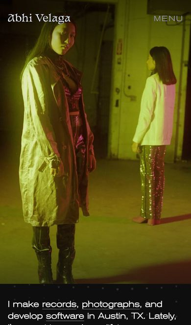
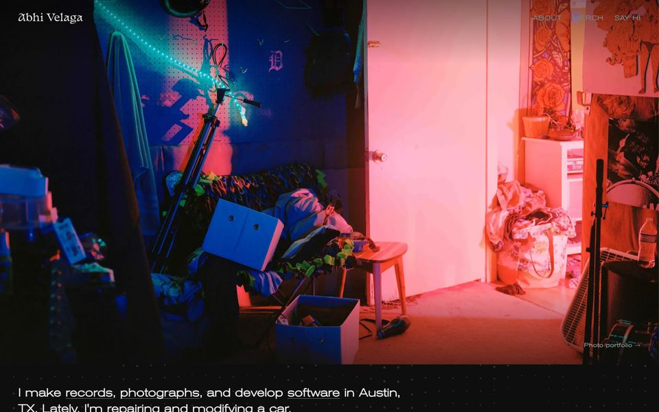
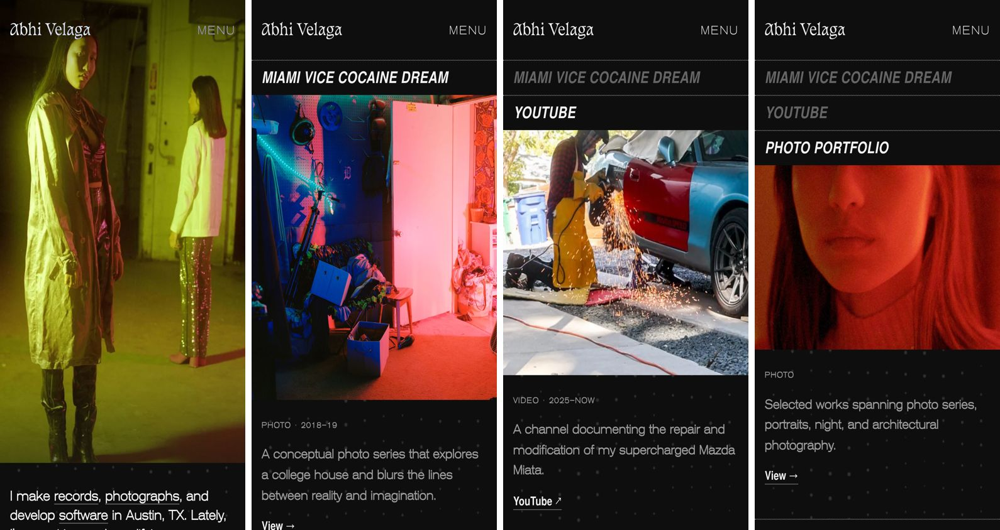

# abhi.work V3: first-impression UX audit (2026-11-06)

**Question:** does a stranger who lands on the site understand what they're looking at, without Abhi there to explain it?

**Why now:** Abhi showed the site on his phone to a designer at work. The designer said it looked cool, but his first reaction was "I'm confused, who's this chick?" The first image was a portrait of a model.

**Method:** the live site (abhi.work), captured on an emulated iPhone 13 at 0, 3 and 9 seconds, then scrolled screen by screen. Desktop (1440×900) for comparison. Each screen was checked against the questions a stranger brings: *whose site is this, what do they do, what am I looking at, where do I go next?*

**Limits:** this is an informed read, not a real first impression; the reviewer already knew whose site it was. It finds structural problems (what's visible when, what reads as what), but only a test with real strangers confirms them (see "Next steps").

## What a stranger sees on a phone

| 0 s | 3 s | 9 s |
|---|---|---|
|  |  |  |
| "Abhi Velaga" above a woman's face that fills the screen. No caption. The intro sentence is mostly cut off. | A band on stage. Which one is Abhi? | Two models in a warehouse. |

Abhi himself first appears around slide 12 of 21.

## Findings, most serious first

### 1. The name reads as the label for the face
A name placed next to a face is read as that face's label. Profiles, ID badges and social cards all work this way, and that habit is stronger than any design intent. So the first phone screen says "this is Abhi Velaga," and the photo is of a model. Two of the first five phone slides are portraits of women, and a third is a band clip where Abhi can't be picked out.

### 2. Phones hide the captions that would label the photos as his work
Desktop shows a small caption on each slide ("Photo portfolio →"), which frames each image as his work. Phones hide it (`.v3-slide-caption { display: none }` in `app/styles/v3.scss`). Without it, a phone visitor can't tell whether Abhi took these photos or is in them.

Desktop is much safer for a second reason: it opens on `laguna-house`, an empty room, so the name has no face to attach to.

### 3. The sentence that explains everything is below the fold
"I make records, photographs, and develop software in Austin, TX. Lately, I'm repairing and modifying a car." answers "who is this" right away. On phones the hero takes about 87% of the screen, so only a line and a half of the sentence shows, while a new slide grabs attention every 3 seconds.

The rule this breaks: the first screen has to say who and what without scrolling. A mood board can come after that.

### 4. Below the hero, the cards work

Once someone scrolls, each card explains itself: a kind and year ("PHOTO · 2018–19") and one plain sentence. Unfamiliar titles like "User Void" and "Indulgent" are fine because of that.

A minor point: on phones, About is behind MENU, so "who is this person" takes a tap. That's acceptable if the first screen does its job.

## Decision: the hero is about him, and the cards carry the range

Abhi's call (2026-11-06): make the hero focus on him and his world, with fewer photoshoots of other people, and let the rest of the site do its own work. It's recorded under "The hero" in `V3-ethos.md`.

The hero and the cards do different jobs. **The hero is the statement:** who this person is and what his life looks like. **The cards are the evidence:** the work, each piece with a title and a sentence. Photoshoots of other people are strong evidence, but in the hero, with no label, they get mistaken for the statement.

**Test for a slide:** if a stranger saw only this shot under the name, would they understand what they're looking at?

### Available shots, sorted

| His world (hero material) | Others' photoshoots (mostly for the cards) |
|---|---|
| **Car:** `cutting-miata`, `welding-under-carport`, `engine-on-stand`, `engine-pull`, `b-roll-engine-crane`, `pushing-miata`, `miata-slo-mo` | `spark1`, `spark2`, `spark3`, `spark-cover` |
| **LED installation:** `dadalab-1`, `dadalab2`, `dadalab-3` | `ania`, `ania2`, `karla`, `red-portrait` |
| **Bands:** `indulgent`, `indulgent-2`, `shivering-demons` | |
| **Places:** `room`, `kitchen`, `living-room`, `laguna-house`, `house-night`, `boxing-gym`, `deyoung`, `user-void-1/2` | |
| **Him:** `me.png` | |

### Things to watch when picking
- **Opening slide:** never a single face, especially one that isn't his.
- **Band clips:** use ones where Abhi can be spotted. A frame of someone else headbanging brings back "who's that?"
- **Only one shot of him.** A hero meant to be about him is thin on him in person. The car clips help (he's the one welding and cutting), but a couple more shots would anchor it: at the drums, under the car, at the desk with the LED. The originals in `v3-assets/hero/picks/` don't include more.
- **Don't swing too far.** With only Miatas and garages, the photographer side disappears. One or two of the strongest portraits in the back half are fine once the opening has set the context.

## Recommended changes

1. **Re-pick both hero sets** around his own world, as above. Reorder at `/dev/hero`, then run `python3 scripts/build-hero.py` and commit `public/hero/` with `hero-picks.json`.
2. **Make the phone hero shorter** so the whole intro sentence fits on the first screen. This is the strongest fix: it answers the question instead of only avoiding the wrong answer.
3. Optional: **show slide captions on phones.**

## Next steps
- **Five-second test** with 3–5 people who don't know Abhi: show the phone home page for 5 seconds, take it away, ask "whose site is this, and what do they do?" Run it before and after the changes. Count the answers that mention the right person and at least one thing he makes.
- Re-screenshot the phone opening after the new picks are built.

Progress is tracked under "First impression on phones" in `V3-todo.md`.
